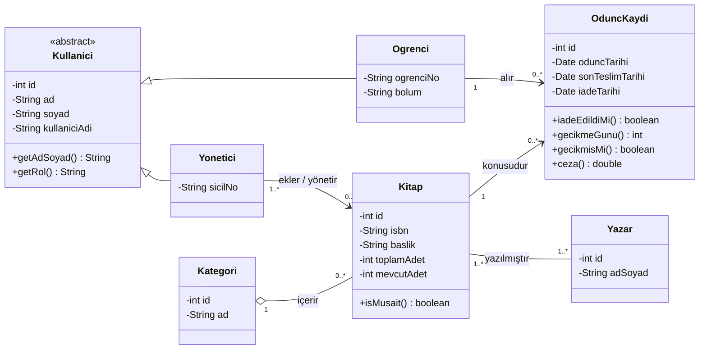
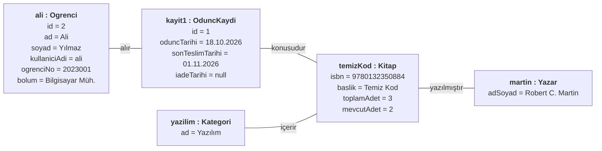
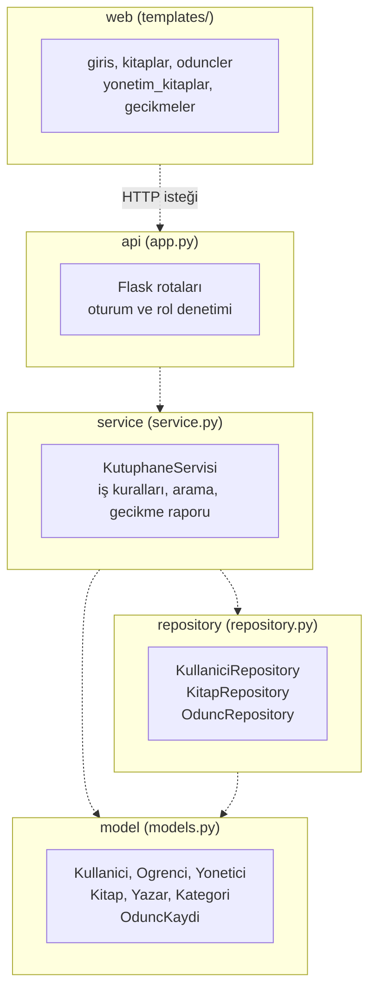
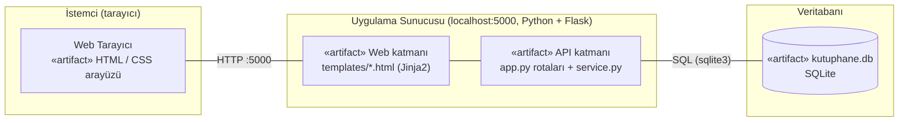

# Online Kütüphane Yönetim Sistemi

Bir üniversitenin öğrencilerinin kitap arayıp ödünç alabildiği ve iade edebildiği kütüphane yazılımı.
Kitap stokları izlenir, gecikmeler raporlanır, yöneticiler kitap ekleyebilir.

- **Dil / teknoloji:** Python 3, Flask (web + API), SQLite (veritabanı)
- **Tasarım:** Nesne tabanlı, katmanlı mimari (web, api, service, repository, model)

## İçindekiler
1. [UML diyagramları](#uml-diyagramları)
2. [Uygulamayı çalıştırma](#uygulamayı-çalıştırma)
3. [Özellikler ve iş kuralları](#özellikler-ve-iş-kuralları)
4. [Proje yapısı](#proje-yapısı)

---

## UML diyagramları

### 1. Class Diagram

7 sınıf bulunur. `Kullanici` soyut sınıftır, `Ogrenci` ve `Yonetici` onu miras alır.
`OduncKaydi`, öğrenci ile kitap arasındaki çoktan çoğa ilişkiyi çözen ilişki sınıfıdır.
Bir kitabın birden çok yazarı olabilir, bir kategori birçok kitap içerir.



| İlişki | Tür | Çokluk |
|---|---|---|
| Kullanici – Ogrenci / Yonetici | Kalıtım (generalization) | - |
| Ogrenci – OduncKaydi | Association | 1 öğrenci, 0..* ödünç kaydı |
| Kitap – OduncKaydi | Association | 1 kitap, 0..* ödünç kaydı |
| Yonetici – Kitap | Association | 1..* yönetici, 0..* kitap |
| Kategori – Kitap | Aggregation | 1 kategori, 0..* kitap |
| Kitap – Yazar | Association (çoktan çoğa) | 1..* kitap, 1..* yazar |

### 2. Object Diagram

Senaryo: Öğrenci Ali Yılmaz, "Temiz Kod" kitabını 18.10.2026 tarihinde ödünç alıyor. Son teslim tarihi 14 gün sonrasıdır.
Kitabın 3 kopyasından biri öğrencide olduğu için rafta 2 kopya kalmıştır.



### 3. Package Diagram

5 mantıksal paket vardır. Oklar bağımlılık yönünü gösterir: üst katman alt katmana bağlıdır, tersi olmaz.



| Paket | Sorumluluk |
|---|---|
| web | HTML sayfaları (Jinja2 şablonları) |
| api | Flask rotaları, giriş ve rol denetimi |
| service | İş kuralları (ödünç limiti, gecikme, ceza, arama) |
| repository | SQLite veri erişimi |
| model | Varlık sınıfları (UML sınıf diyagramındaki sınıflar) |

### 4. Deployment Diagram

Uygulama yerel çalışır. Tarayıcı, aynı makinedeki Flask sunucusuna bağlanır. Sunucu web arayüzünü (HTML şablonları)
ve API rotalarını birlikte sunar, veriler SQLite dosyasında tutulur. İnternet bağlantısı gerekmez.



---

## Uygulamayı çalıştırma

Gereksinim: Python 3.8 veya üstü.

```bash
pip install -r requirements.txt     # sadece ilk seferde internet gerekir
python app.py
```

Ardından tarayıcıda <http://127.0.0.1:5000> adresini aç.
Windows'ta `python` çalışmazsa `py`, Mac/Linux'ta `python3` kullan.

Veritabanı (`kutuphane.db`) ilk çalıştırmada örnek verilerle otomatik oluşur.
Verileri sıfırlamak için `kutuphane.db` dosyasını silip uygulamayı yeniden başlat.

### Demo hesaplar

| Rol | Kullanıcı adı | Şifre |
|---|---|---|
| Yönetici | `admin` | `admin123` |
| Öğrenci | `ali` | `1234` |
| Öğrenci | `zeynep` | `1234` |

Zeynep'in 30 gün önce aldığı ve iade etmediği bir kitap vardır; yönetici girişinde **Gecikme raporu** sayfasında görünür.

## Özellikler ve iş kuralları

**Öğrenci**
- Kitap arama: başlık, yazar, ISBN veya kategoriye göre (Türkçe karakter ve büyük/küçük harf duyarsız)
- Kitap ödünç alma ve iade etme, kendi ödünç geçmişini görme

**Yönetici**
- Kitap ekleme ve mevcut kitaba adet ekleme (stok yönetimi)
- Gecikme raporu: geciken kayıtlar, gecikme günü, ceza tutarı, iadeyi alma
- Öğrenci ekleme

**İş kuralları**
- Ödünç süresi 14 gündür.
- Bir öğrenci aynı anda en fazla 3 kitap alabilir.
- Stokta olmayan kitap ödünç verilemez; ödünçte stok düşer, iadede artar.
- Gecikmiş kitabı olan öğrenci yeni kitap alamaz.
- Gecikme cezası günlük 2 TL'dir.

## Proje yapısı

```
kutuphane/
├── app.py            # api paketi: Flask rotaları
├── service.py        # service paketi: iş kuralları
├── repository.py     # repository paketi: SQLite erişimi
├── models.py         # model paketi: varlık sınıfları
├── templates/        # web paketi: HTML şablonları
├── requirements.txt
└── README.md
```
